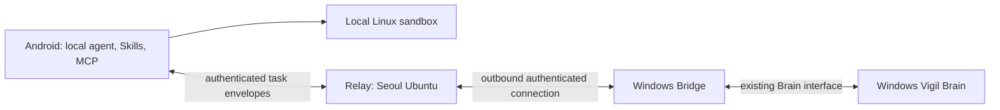

# Kestrel architecture

Kestrel is the Android application in [limingyi2/kestrel-app](https://github.com/limingyi2/kestrel-app), a GitHub fork of [nanoMuse](https://github.com/nano-muse/nanoMuse). This document distinguishes the inherited implementation from the integration to build. The Windows Brain remains in [Vigil](https://github.com/limingyi2/vigil). No Vigil source is copied here and the two agent loops are not merged.

## Boundaries



| Component | Current source / intended responsibility | Status |
|---|---|---|
| Android | `android/src/android/app`: OpenMinis agent, nanoMuse UI and integrations; local model configuration, sessions, permissions | Inherited, brand initialization in this PR |
| Linux sandbox | `com/openminis/app/sandbox`, `android/deps/proot`, rootfs preparation, native offload | Retained, not replaced |
| Skills and MCP | Existing OpenMinis skills repository, MCP clients, CLI and sandbox paths | Retained contracts |
| Relay | `cloud/`: existing FastAPI authentication, device hub and sync; future deployment on Ubuntu in Seoul | Source inherited; Kestrel server not deployed or verified |
| Windows Bridge | A future adapter to the existing Vigil Brain interface | Design only; no Brain implementation in this repo |
| Protocol | Task identity, status receipts, scoped permissions across the relay and bridge | Proposed below; not an implemented transport |

The inherited desktop plugin, Python runtime and iOS sources remain in the fork to retain upstream history and mergeability. They are not the Kestrel Windows Brain, and this initialization does not ship or rebrand them.

## Android and sandbox contracts

The install identity is `io.github.limingyi2.kestrel`. Kotlin packages and the Gradle namespace remain `com.openminis.app` and `io.github.nanomuse.*`. The external scheme is `kestrel://`; `OwnScheme` normalizes it to internal `minis://`. No external `minis` or `nanomuse` scheme is registered by Kestrel.

Keep `/var/minis`, `minis-global`, `MinisSkills`, `minis-mcp-cli`, `android-*`, `X-Minis-Token`, rootfs layout and offload framing. `OffloadSocketName.forApp(BuildConfig.APPLICATION_ID)` produces `io.github.limingyi2.kestrel.native-offload`; PID fallback and the actual bound name passed to proot remain unchanged. A separate application ID means separate app data and no in-place nanoMuse installation upgrade.

The inherited nanoMuse Cloud endpoint and account flows still exist and retain their real service name. They do not point to a Kestrel Seoul service. Selecting a self-hosted relay requires an operator-provided endpoint, valid TLS and account setup. No host, credential or speculative deployment value is committed. Before a Kestrel release, verify all sign-in, privacy, sync and hub flows against the intended server and document where data goes.

## Relay and Windows Bridge

The Seoul relay should authenticate accounts and devices, route task envelopes, persist task status and receipts, and enforce account isolation, quotas, expiration and replay protection. It does not become another agent kernel. Keep existing `/v1/hub` frames compatible; introduce an explicitly versioned adapter after reviewing [hub.md](hub.md) and [cloud.md](cloud.md).

The Windows Bridge should establish an outbound TLS connection to the relay, authenticate as one registered device, translate a permitted task to Vigil's existing API, and translate progress/results back. Inspect the actual Vigil interface before implementation. Do not expose the Brain directly to the Internet, copy its source, move its storage into Android, or treat relay authentication as permission to execute every tool.

## Proposed task protocol

This is an integration contract proposal, not a claim that the inherited hub already implements it.

| Field | Rule |
|---|---|
| `protocol_version` | `kestrel.task.v1`; reject unknown major versions explicitly |
| `task_id` | Origin-generated UUIDv4; stable across all devices and retries |
| `attempt_id` | New UUIDv4 for each execution attempt; never duplicate execution for an acknowledged attempt |
| Account and devices | Relay derives the account from authentication; verifies source and target device membership, not caller-supplied account text |
| `parent_task_id` | Optional delegation correlation; never an authorization grant |
| `created_at`, `expires_at` | UTC RFC3339; expired tasks cannot start; validate clock skew |
| `sequence` | Monotonic within an attempt; duplicate receipts are idempotent; reject conflicting replay |
| Payload | Typed action and arguments, bounded size, content digest; no embedded provider token or signing key |
| Permission | Bind action, canonical argument digest, target device, approving identity, expiration and one-use nonce to authenticated evidence |

Receipts use `accepted`, `awaiting_permission`, `running`, `succeeded`, `failed`, `cancelled` or `expired`, with task/attempt IDs, sequence, UTC time and an optional typed error/result reference. `accepted` acknowledges durable receipt only. Terminal states are immutable; reconnect queries resume from the last durable sequence. Cancellation is a request until the target acknowledges it; a lost connection is not success. The UI must show an unknown outcome and reconcile before retrying a side effect.

Each executor retains its native permission gate. The Android approval gate and Vigil's own authorization both apply where relevant. A missing/expired approval, mismatched digest or unrecognized risk class fails closed. Trusting a device for connection does not approve payments, destructive actions or credential access. Approval must not be carried from one step to another. Task status and logs redact secrets; results stay in the account and use expiring access-controlled references for large artifacts.

## Upstream updates

```sh
git remote -v
git fetch upstream --tags
git switch -c chore/update-nanomuse
git merge upstream/main
python scripts/rebrand.py
python scripts/rebrand.py --check
```

Review conflicts against the preserved upstream branding implementation in `scripts/rebrand.py`. The default entry point uses `scripts/kestrel_brand.py`, an Android-only allowlist. Do not call `upstream_main` to initialize Kestrel. Do not run icon generators until the temporary assets or approved Kestrel source are intentionally selected. Retain LICENSE, NOTICE, third-party notices, `.gitmodules` and gitlink SHAs. Open a PR and run the Android checks before merging. Do not push to the Vigil remote.

## Acceptance before release

Build arm64 debug with the inherited Android CI: native proot/rootfs/rclone, `assembleDebug`, scoped unit tests, Android instrumentation compilation and APK badging. Check the built APK label and install ID. No release APK, signing key or release tag is produced by this initialization.

On a real arm64 phone, install alongside nanoMuse, launch the Linux shell, execute a command through native offload, import/run a Skill, connect MCP, open an attachment and `kestrel://settings/soul`, and verify approval allow/deny and app restart. The inherited emulator option is chat-only and cannot validate the sandbox. Complete a separate Android/Seoul/Windows integration test once the bridge is implemented.
